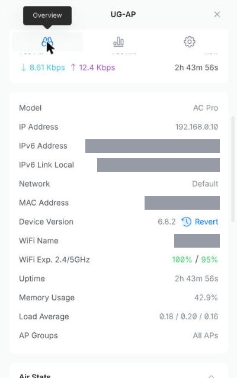
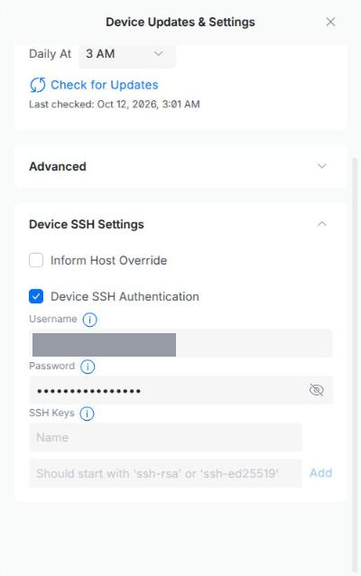
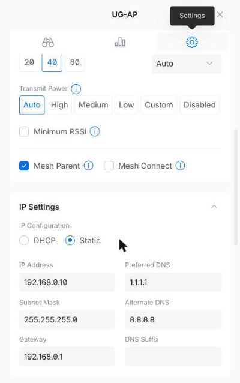

# UniFi Access Points

Diese Seite enthält alles, was die WLAN-Geräte selbst betrifft: den
Alltag, die Störungsbehebung und das Zurücksetzen und Neueinrichten
eines Geräts. Die Installation des Controllers auf dem Server steht
getrennt unter [UniFi Controller (Docker)](11-unifi-controller.md) und
wird hier nicht gebraucht.

Die Abschnitte 1 bis 7 kommen ohne Vorkenntnisse aus. Ab Abschnitt 8
braucht es ein Terminal.

## 1. Das Wichtigste in Kürze

- Im Haus hängen zwei WLAN-Sender (**Access Points**): `UG-AP` und
  `Licht-AP`. Beide strahlen dasselbe WLAN aus; Geräte wechseln von
  selbst zum nächstgelegenen.
- Verwaltet werden sie über eine Webseite, den **Controller**. Er läuft
  auf dem Server im Haus.
- Das WLAN funktioniert auch, wenn der Server aus ist. Nur die
  Verwaltungsseite ist dann nicht erreichbar.
- Updates installieren sich von selbst, jede Nacht um 3 Uhr.

## 2. Die Lampe am Access Point

| Lampe | Bedeutung | Was tun |
| --- | --- | --- |
| Blau, dauerhaft | Alles in Ordnung | Nichts |
| Weiss, blinkend | Gerät startet | Zwei Minuten warten |
| Weiss und blau im Wechsel | Update läuft | Warten, **nicht ausstecken** |
| Blau, mit kurzen Aussetzern | Keine Verbindung zum Netzwerk | Siehe Abschnitt 5 |
| Weiss, dauerhaft | Gerät ist nicht eingerichtet | Einrichten, siehe Abschnitt 9 |
| Aus | Kein Strom | Siehe Abschnitt 5 |

## 3. Den Controller öffnen

1. Verbinde dich mit dem Netzwerk im Haus und öffne im Browser
   `https://192.168.0.50:8443`.
2. Der Browser warnt vor einer unsicheren Verbindung. Das ist hier
   normal: Klicke auf *Erweitert* und dann auf *Weiter zu
   192.168.0.50*.
3. Melde dich mit dem Verwaltungskonto an.
4. Ein Fenster mit dem Titel *Upgrade to UniFi OS Server* kannst du mit
   dem Kreuz oben rechts schliessen.

## 4. Nachsehen, ob alles läuft

Klicke links auf **UniFi Devices** (das runde Symbol). Die Liste zeigt
beide Access Points mit ihrem Zustand.


- **Online** mit grünem Punkt: Das Gerät funktioniert.
- **Offline** in grauer Schrift: Das Gerät ist nicht erreichbar.

Ein Klick auf ein Gerät öffnet rechts die Details. Im Tab **Overview**
stehen Modell, IP-Adresse, MAC-Adresse und Version.



## 5. Wenn etwas nicht geht

Gehe die Schritte der Reihe nach durch und prüfe nach jedem, ob das
Problem behoben ist.

### Das WLAN ist an einem Ort schwach oder weg

1. Schau auf die Lampe des nächstgelegenen Access Points und vergleiche
   mit der Tabelle in Abschnitt 2.
2. Ist die Lampe aus: Prüfe, ob das kleine Netzteil (**PoE-Injektor**)
   in der Steckdose steckt und beide Kabel daran fest sitzen. Die
   Buchse `POE` führt zum Access Point, `LAN` zum Router oder Switch.
3. Starte das Gerät neu: Ziehe das Netzteil aus der Steckdose, warte
   zehn Sekunden und stecke es wieder ein. Nach zwei bis drei Minuten
   sollte die Lampe dauerhaft blau leuchten.

### Das WLAN ist im ganzen Haus weg

1. Prüfe zuerst den Router: Funktioniert das Internet an einem Gerät,
   das per Kabel angeschlossen ist?
2. Starte beide Access Points nacheinander neu, wie oben beschrieben.

### Ein Gerät ist im Controller "Offline", das WLAN geht aber

Das Gerät arbeitet, erreicht aber den Controller nicht.

1. Prüfe, ob der **Inform Host Override** gesetzt ist (Abschnitt 8).
2. Teile dem Gerät die Controller-Adresse erneut mit (Abschnitt 9,
   Schritt 3, mit dem Login aus Abschnitt 8 statt `ubnt`).

### Nach einem Stromausfall

Es ist nichts zu tun. Alle Geräte starten von selbst und behalten ihre
Einstellungen.

### Wenn nichts davon hilft

Bleibt ein Gerät nach Neustart und zehn Minuten Wartezeit aus, offline
oder dauerhaft weiss, setze es zurück und richte es neu ein
(Abschnitt 9).

## 6. Neustart und Lampe über den Controller

Klicke in der Geräteliste auf ein Gerät, wechsle auf den Tab
**Settings** (Zahnrad) und scrolle zum Abschnitt **Manage**.

| Funktion | Wirkung |
| --- | --- |
| **Restart** | Startet das Gerät neu, ohne dass jemand hingehen muss. |
| **Locate** | Lässt die Lampe blinken, um das Gerät zu finden. |
| **LED** | Schaltet die Lampe dauerhaft ein oder aus. |
| **Remove** | Entfernt das Gerät aus dem Controller und setzt es zurück. Danach muss es neu eingerichtet werden. |
| **Disable** | Schaltet das WLAN dieses Geräts ab. |

## 7. Updates

Updates für die Access Points installieren sich automatisch. Das Gerät
startet dabei neu, und das WLAN fällt an diesem Ort für einige Minuten
aus. Deshalb geschieht es nachts um 3 Uhr.

Den Zeitpunkt und den Stand siehst du unter *UniFi Devices* ->
**Device Updates & Settings** (unten links).

## 8. Grundeinstellungen im Controller

Öffne **UniFi Devices** und klicke unten links auf **Device Updates &
Settings**. Im Abschnitt **Device SSH Settings** liegen zwei
Einstellungen, die für alle Geräte gelten.



- **Inform Host Override:** muss aktiviert sein und `192.168.0.50`
  enthalten. Der Controller läuft in einem Container und würde den
  Geräten sonst eine Adresse nennen, die sie nicht erreichen.
- **Device SSH Authentication:** Benutzername und Passwort für die
  SSH-Anmeldung auf eingerichteten Geräten. Das Auge neben dem Passwort
  zeigt es im Klartext.

## 9. Access Point zurücksetzen und neu einrichten

Dieser Ablauf gilt für ein neues Gerät genauso wie für eines, das nicht
mehr reagiert. Das Gerät verliert dabei alle Einstellungen und erhält
sie in Schritt 4 vom Controller zurück.

1. **Zurücksetzen.** Halte den Reset-Knopf neben der Netzwerkbuchse mit
   einer Büroklammer rund 10 Sekunden gedrückt, während das Gerät Strom
   hat. Es startet neu; danach leuchtet die Lampe dauerhaft weiss.

2. **Anschluss prüfen.** Das Gerät muss per Netzwerkkabel verbunden
   sein. Am PoE-Injektor: `POE` zum Access Point (Port `Main`), `LAN`
   zum Router oder Switch.

3. **Controller-Adresse setzen.** Das Gerät findet den Controller nicht
   von selbst. Seine IP-Adresse steht in der Geräteliste des Routers;
   Benutzer und Passwort sind nach dem Zurücksetzen beide `ubnt`.

    ```bash
    ssh ubnt@<ap-ip>
    set-inform http://192.168.0.50:8081/inform
    ```

    Das allgemeine Format ist
    `set-inform http://<controller-ip>:8080/inform`. `8080` ist der
    Standard-Port eines UniFi-Controllers; hier gilt `8081`, weil `8080`
    auf dem Server bereits belegt ist.

    Falls SSH mit `no matching host key type` abbricht:

    ```bash
    ssh -o HostKeyAlgorithms=+ssh-rsa -o PubkeyAcceptedAlgorithms=+ssh-rsa ubnt@<ap-ip>
    ```

4. **Adoptieren.** Das Gerät erscheint unter *UniFi Devices*. Klicke auf
   **Adopt**. War es bereits in der Liste, übernimmt es seine früheren
   Einstellungen. Bleibt es in "Adopting" hängen, führe den
   `set-inform`-Befehl ein zweites Mal aus.

5. **Kontrollieren.** Die Lampe leuchtet dauerhaft blau, und das Gerät
   steht in der Liste auf "Online". Bei einem neuen Gerät folgen Name,
   Firmware-Update und die statische IP-Adresse (Abschnitt 10).

Ab der Adoption gilt das SSH-Login aus Abschnitt 8, nicht mehr `ubnt`.
Zusammen mit der statischen IP-Adresse aus Abschnitt 10 lautet die
Anmeldung dann:

```bash
ssh <new-username>@<static-ip>
```

!!! note "Wann zurücksetzen?"

    Ein Neustart (Strom kurz trennen) löscht nichts und ist immer der
    erste Versuch. Zurücksetzen ist der zweite Schritt, wenn das Gerät
    danach weiterhin nicht läuft.

## 10. Statische IP-Adresse

Öffne das Gerät in der Liste, wechsle auf den Tab **Settings**
(Zahnrad) und scrolle zu **IP Settings**. Stelle von `DHCP` auf
`Static` um.



| Feld | Wert |
| --- | --- |
| IP Address | `192.168.0.10` (`UG-AP`), `192.168.0.11` (`Licht-AP`) |
| Subnet Mask | `255.255.255.0` |
| Gateway | `192.168.0.1` |
| Preferred DNS | `1.1.1.1` |
| Alternate DNS | `8.8.8.8` |

Die Adressen müssen ausserhalb des DHCP-Bereichs des Routers liegen,
sonst vergibt dieser sie womöglich ein zweites Mal.

## 11. WLAN und Mesh

**WLAN anlegen oder ändern** unter *Settings -> WiFi*: Name und
Passwort. Das Netz wird automatisch auf allen Access Points
ausgestrahlt.

### Mesh (nicht in Gebrauch)

Beide Access Points hängen am Kabel, ein Funk-Uplink (Mesh) wird nicht
verwendet. Soll später ein Gerät ohne Netzwerkkabel dazukommen:

1. Die Schalter liegen pro Gerät im selben Tab wie die
   IP-Einstellungen, direkt über *IP Settings*:

    - **Mesh Parent** beim verkabelten Access Point.
    - **Mesh Connect** beim Access Point ohne Netzwerkkabel.

2. Das Gerät zuerst am Kabel einrichten, dann am Zielort nur mit Strom
   versorgen. Nach fünf bis zehn Minuten ist es mit Funk-Uplink wieder
   "Online".

Ein Funk-Uplink durch Betondecken ist die häufigste Ursache für
instabile Access Points. Wo immer möglich, gehört ein Kabel hin.

## 12. Angaben wiederfinden

| Gesucht | Ort |
| --- | --- |
| MAC-Adresse, IP, Firmware-Version | Gerät anklicken, Tab **Overview** |
| Statische IP ändern | Gerät anklicken, Tab **Settings** -> *IP Settings* |
| SSH-Benutzer und -Passwort | *UniFi Devices* -> **Device Updates & Settings** -> *Device SSH Settings* |
| Inform Host Override | ebenda |
| Inform-Adresse für `set-inform` | `http://192.168.0.50:8081/inform` |
| SSH-Anmeldung auf einem eingerichteten Gerät | `ssh <new-username>@<static-ip>` |
| Version des Controllers | Dashboard, Kachel oben links |
